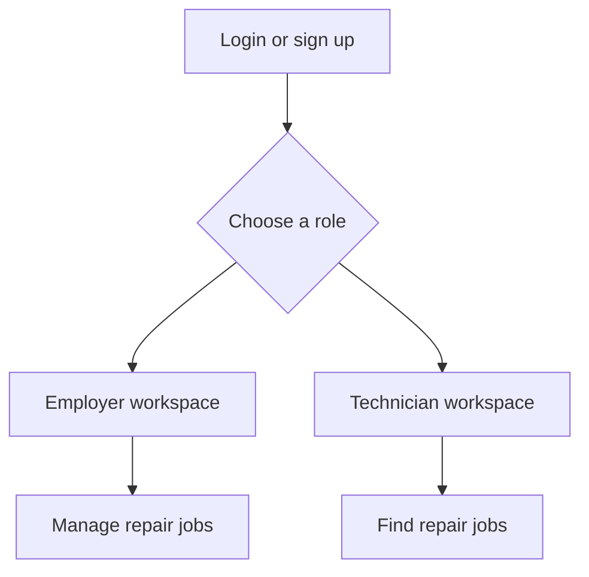
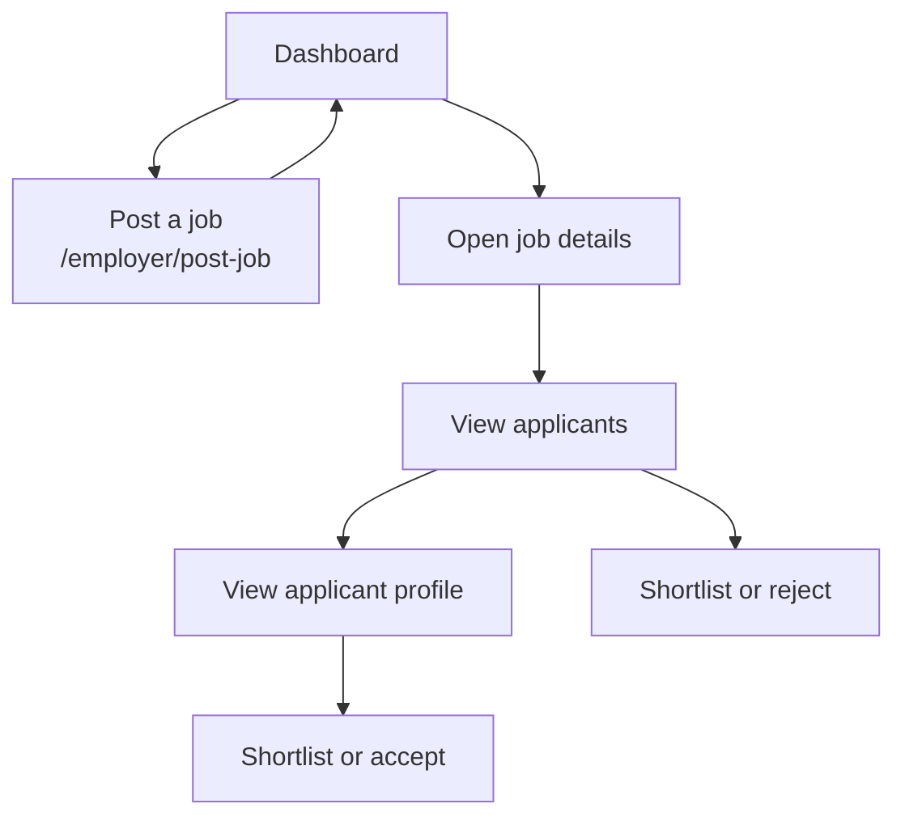
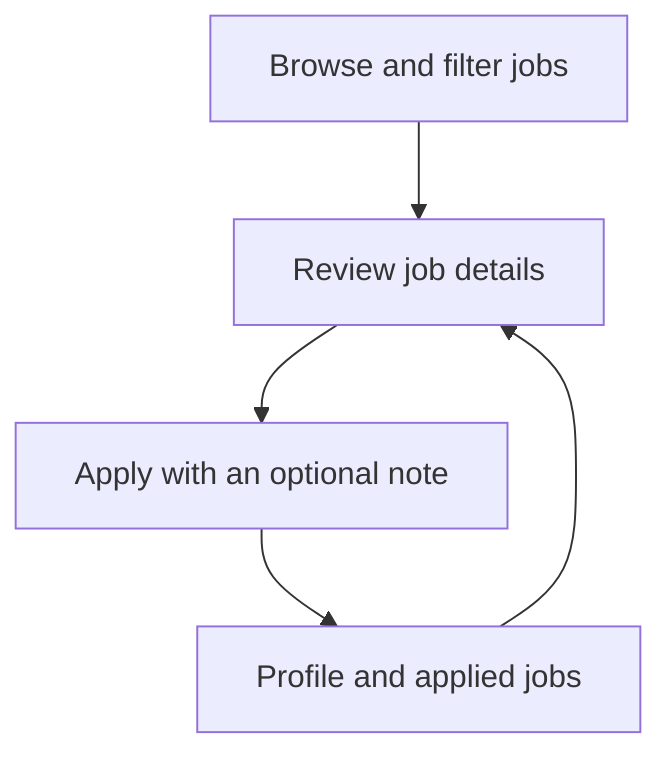

# RepairConnect

RepairConnect is a front-end prototype that connects repair shops with technicians for mobile, iPhone, Android, laptop, and MacBook repair work.

## Run locally

From this directory, install dependencies and start the development server:

```bash
npm install
npm run dev
```

Open [http://localhost:3000](http://localhost:3000). Run `npm run build` to create a production build, or `npm run lint` to check the source.

## Routes

| Page                       | What the user can do                                                                    |
| -------------------------- | --------------------------------------------------------------------------------------- |
| `/`                        | Redirect to sign in.                                                                    |
| `/login`                   | Choose an Employer or Technician workspace and sign in with mock credentials.           |
| `/signup`                  | Choose a role, enter the matching details, and continue to that workspace.              |
| `/employer/dashboard`      | Review job and applicant counts, browse posted jobs, and start a new post.              |
| `/employer/post-job`       | Enter repair details, pay, location, urgency, and required skills.                      |
| `/employer/job/[id]`       | Review a job and its applicants; shortlist or reject applicants.                        |
| `/employer/applicant/[id]` | Review an applicant's profile, experience, portfolio, and reviews; shortlist or accept. |
| `/tech/dashboard`          | Search and filter open jobs by device, city, and pay.                                   |
| `/tech/job/[id]`           | Review repair and shop details, then apply with an optional cover note.                 |
| `/tech/profile`            | Review the technician profile, reviews, work samples, and applied jobs.                 |

## Design choices

I used teal with amber accents to balance trust and energy.
The card-based layout and persistent sidebar keep repeated navigation quick, while Inter keeps dense job details readable.


## How it works 

RepairConnect gives repair shops and repair technicians one place to find each other. Shops post repair work with the device, issue, location, pay, and skills needed. Technicians browse and filter those jobs, then apply with an optional note. Shops review the applicants and can shortlist, reject, or accept them.

### Overall flow



### Employer flow



### Technician flow



## What's mocked vs what's real

All shops, technicians, jobs, applications, reviews, and ratings are sample data. Login and signup only route between mock workspaces; there is no real account, database, or server-side saving, so in-session changes reset on refresh. A production version would need a backend, a database, and real authentication.